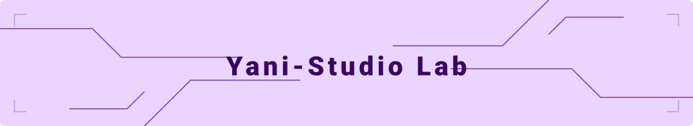

  
  
  

    
  

  
  

    
  

---

## 👨‍💻 Core Competencies

* 🎓 **Education:** 경희대학교 인공지능학과 석사 졸업 `(4.01 / 4.5)` | 수도권 4년제 대학 산업공학·데이터 전공 학사 졸업 `(4.01 / 4.5)`
* 🎯 **Research Focus:** `Machine Vision & Edge AI` | `Enterprise AI & RAG (NL2SQL)` | `Time-Series Forecasting & PHM` | `Operations Research`
* ✉️ **Contact:** rbals985865@naver.com | rbals985865@khu.ac.kr

---

## 📊 Verified Credentials & Core Achievements

> 💡 **주요 학술 성과, 수상 내역 및 대외 협력 프로젝트 요약**

| 🏆 Credential | Research & Project | Domain | Key Metric / Impact |
| :--- | :--- | :--- | :--- |
|  **SCIE 1저자** | 반도체 웨이퍼 결함 분류 초경량화 AI (SCRBLAA-Net) | Vision & Edge | `VRAM 3.2GB 절감` / **Acc 94.98% 달성** |
|  **캐글 1위** | XAI 기반 적외선(IR) 태양광 모듈 초정밀 결함 탐지 | Vision AI | 글로벌 앙상블 모델 최적화 / **Acc 96.2%** |
|  **전국 2등 돌파** | 정부 공모전 환각 제어 식품 과학 RAG 챗봇 | Enterprise AI | 탐색 효율 `80% 향상` / **일치율 9배 상승** |
|  **경희대 대회 1위** | 풍력 터빈 데이터 증강(GAN) 및 데이터 부패 규명 | Time-Series | 예측 오차 `59.2% 절감` / **연 6억 원 절감 입증**
|  **서울시 사업** | 서울시 헬스케어(손목닥터 9988) 선제적 모니터링 아키텍처 | Data Analysis | **`45만 명`** 데이터 분석 및 자동화 리포팅 기반 확립 |
|  **산학 공동 연구** | 연세대학교 협력 LLM 대화 실패 탐지 벤치마크 구축 | LLM & RAG | 차세대 LLM 성능 평가 지표 및 프레임워크 설계 |
|  **글로벌 성능** | 엔트로피 기반 앙상블 파이프라인 활용 PCB 결함 분류 | Vision AI | 글로벌 벤치마크 기준 세계 1위 성능 **`Acc 99.80%`** |

---

## 🚀 Core Research & Projects
> 💡 **Tip:** 각 프로젝트의 제목을 클릭하시면 상세한 핵심 성과와 적용 기술을 확인하실 수 있습니다.

### 👁️ 1. Vision AI & Edge Deployment

<b>[SCIE 1저자] 반도체 웨이퍼 결함 분류 초경량화 AI (SCRBLAA-Net)</b> <code>Paper</code> <code>Code</code>

 

* **Core Approach:** 고차원 특징을 슬라이딩 윈도우 방식으로 분할 및 토큰화하여, 대규모 이미지 모델의 고질적 과적합과 핵심 공정 데이터 유실을 원천 차단하는 공정 학습 방법론 고안.
* **Key Impact:** VRAM 3.2GB만을 사용하는 모델 경량화를 달성하며 결함 분류 **정확도 `94.98%(+1.67%p)`** 확보 및 제조업 JCR Q2 등급 SCIE 저널 **제1저자 논문 게재**.
* **Artifacts:** 3차원 점 지도(t-SNE Plot) 시각화로 분류 신뢰성을 증명하고, 8가지 고장 유형 분포와 고속 이진화 전처리 과정을 직접 체험할 수 있는 HTML 기반 인터랙티브 웹 시뮬레이터를 독자 개발 및 배포.

<b>[전세계 1등 성능] 엔트로피 기반 앙상블 AI 활용 PCB 결함 분류</b> <code>Code</code>

 

* **Core Approach:** 50개 이상의 CNN 아키텍처 대상 대규모 절제 연구(Ablation Study)를 거쳐, 모델 예측 불확실성을 배제하는 '엔트로피 기반 앙상블(ResNet50+MobileNet)' 파이프라인 단독 개발.
* **Key Impact:** 3단계 전이 학습 및 명시적 메모리 최적화(Apple M5)를 통해 글로벌 벤치마크 기준 **결함 분류 정확도 `99.80% (SOTA)`**라는 전 세계 1위 성능 달성.
* **Artifacts:** 3차원 점 지도(3D t-SNE)를 활용해 복잡한 결함 클래스가 고차원 공간에서 명확히 분리됨을 증명하고, 기획부터 하드웨어 최적화까지 단독 연구 전 과정을 깃허브에 투명하게 오픈소스화.

<b>[캐글 1위] XAI 기반 적외선(IR) 태양광 모듈 초정밀 결함 탐지</b> <code>Competition</code>

 

* **Core Approach:** 극심한 클래스 불균형 해결을 위해 텐서 복제 기반 전처리 및 3단계 동결 해제 학습을 적용하고, 23개 비전 모델과 30개 앙상블 조합을 완전 탐색하는 파이프라인 구축.
* **Key Impact:** 상위 5개 모델 기하평균 및 임계값(0.54) 정밀 튜닝으로 **결함 분류 정확도 `96.2%`** 달성, 원작자 베이스라인 대비 **`4.15%p` 향상된 캐글 1위 성능** 기록.
* **Artifacts:** XAI(Grad-CAM) 기법을 통합해 12종의 비정상 발열 패턴을 픽셀 단위로 국소화하여 양품 오분류 원천 차단을 증명하고, 전처리부터 검증까지 전 과정을 오픈소스로 투명하게 공개.

<b>[MVTec AD] 비지도 학습 기반 산업용 고정밀 이상 탐지</b> <code>Code</code>

 

* **Core Approach:** 불량 데이터가 부족한 제조 현장의 한계 극복을 위해, 정상 데이터만으로 결함을 검출하는 고속 추론용 EfficientAd와 정밀 검출용 Patchcore 모델 병렬 파이프라인 구축.
* **Key Impact:** 부품별 임계값 정밀 튜닝을 통해 현업 고질적 문제인 **`과검(False Alarm) 0건`**을 달성하며 부품(Grid)별 최대 100% 분류 성능 확보 및 실질 정확도 최대 **`2.56%p` 향상**.
* **Artifacts:** MPS 백엔드 가속 및 메모리 누수 제어 기법을 적용해 단일 환경에서 999 Epochs 장기 학습을 안정적으로 완수하고, 픽셀 레벨의 이상치 히트맵 시각화 코드를 오픈소스로 공개.

<b>[CoreML] 실시간 다중 차량 인식 경량화 AI 모델</b> <code>App</code>

 

* **Core Approach:** 분산된 12개 객체 라벨을 3개로 통합하는 파이프라인 재정비 및 입력 해상도 조정(640)을 통해, 성능 저하 없이 연산 효율을 극대화하는 경량화 아키텍처 설계.
* **Key Impact:** 맞춤형 메모리 정리 및 조기 종료(Early Stopping) 전략 도입으로 모델 과적합을 방지하고, 정밀도 **`32.64%p` 향상(78.24%)** 및 추론 지연시간 **`31% 단축(9.05ms)`** 달성.
* **Artifacts:** Apple CoreML 전용 가속 포맷으로 변환해 하드웨어 처리 효율을 극대화하고, 경부고속도로 CCTV 기반 실시간 탐지 시연 성공 및 전처리 파이프라인 전체를 오픈소스로 공개.

---

### 🧠 2. Enterprise AI & Large Language Models

<b>[100% 온프레미스] 차세대 RAG-NL2SQL 보안형 ERP 엔진</b> <code>Architecture</code>

 

* **Core Approach:** 민감한 기업 핵심 자산의 클라우드 유출 방지를 위해, 외부 서버 연결 없이 100% 로컬 네트워크에서 구동되는 Ollama 기반 RAG-NL2SQL 엔진 및 자가 수정(Reflexion) 루프 설계.
* **Key Impact:** 노이즈 주입 엣지 케이스 파이프라인과 8시간의 자율 튜닝 프로세스 도입으로 극단적 환경에서 **`방어율 100%`**를 기록하고, Codestral 모델 기준 **`1.65ms 내 데이터 일치율 100%`** 달성.
* **Artifacts:** 자연어만으로 3가지 모의 ERP 스키마(HR, 재무 등)를 제어할 수 있는 이중 언어(Bilingual) 지원 글래스모피즘 Streamlit UI를 구축하여 깃허브에 투명하게 오픈소스화.

<b>[정부 데이터 공모전 전국 2등] 환각 제어(Hallucination-Free) 식품 과학 RAG 챗봇</b> <code>Demo</code>

 

* **Core Approach:** AI가 허위 정보를 진실처럼 생성하는 환각 현상을 원천 차단하기 위해, 문서 데이터를 문장 단위로 연결하고 검색 증강(RAG) 기술을 결합한 하이브리드 교차 검증 파이프라인 구축.
* **Key Impact:** 원문 데이터와 대조해 엄격한 규칙을 통과한 정보만 출력하도록 통제하여 탐색 효율을 **`80% 향상`**시키고, 범용 AI 대비 초록 생성 일치율을 **`9배 수직 상승`** 달성.
* **Artifacts:** 교수진 및 실무진 심사에서 기술적 객관성과 안전망을 완벽히 검증받아 데이터 분석·활용 공모전 **전국 2등(최우수상) 수상** 및 사용자 친화적 웹 인터페이스 구현.

<b>[연세대 협력 프로젝트] 차세대 LLM 대화 실패 탐지 및 평가 벤치마크 구축</b> <code>Private Repo</code>

 

* **Status:** 논문 출판 및 지식재산권(IP) 보호를 위해 현재 연구 데이터와 핵심 코드는 **프라이빗(Private)** 레포지토리에서 엄격하게 보안 유지 중입니다. (학술지 게재 완료 후 제한적 오픈소스 전환 예정)

---

### 📈 3. Time Series & Predictive Maintenance (PHM)

<b>[Walmart ERP] 4,700만 건 대규모 공급망 수요 예측 메타 앙상블</b> <code>Pipeline</code>

 

* **Core Approach:** 전체 데이터의 80% 이상이 0인 영과잉(Zero-inflated) 특성을 극복하기 위해, 수요 발생 여부와 판매 수량을 완벽히 분리하는 투 스테이지 허들(Two-Stage Hurdle) 아키텍처 고안.
* **Key Impact:** 53개 단일 모델 및 50개 앙상블 전수조사를 거쳐 머신러닝·딥러닝 하이브리드 메타 앙상블(Tweedie loss 결합)을 설계하고, 정밀도 하락 없이 최종 **`F1-Score 0.67`** 확보.
* **Artifacts:** Zero-copy 메모리 최적화로 대용량 학습 과정의 OOM을 차단하여 소요 시간을 **`15분 이상 단축`**했으며, 압도적 성능을 입증하는 혼동 행렬 시각화 자료와 파이프라인 전체를 오픈소스 배포.

<b>[NASA C-MAPSS] 항공 엔진 다중 운전 조건 하이브리드 예후진단</b> <code>Research</code>

 

* **Core Approach:** 다중 운전 조건(6 Regimes) 하의 미검출 오진단 방지를 위해, CNN-BiLSTM-Attention 및 Dual Transformer Encoder를 결합하여 국소·전역 패턴을 동시 추출하는 PHM 파이프라인 구축.
* **Key Impact:** 결함 조건별로 기하 평균(Geometric) 및 Soft-Min 앙상블을 교차 적용하고 정비 마진을 최적화 튜닝하여, 기존 베이스라인 모델 대비 **`FD004 패널티 점수 90.4% 감축`**.
* **Artifacts:** Apple M5 하드웨어 최적화로 실시간 연산 속도를 확보하고, API를 통해 Voiceflow 지능형 에이전트 및 RAG 구조를 통합하여 실시간 현장 정비 모니터링 환경 완벽 구현.

<b>[SECS/GEM] 반도체 장비 결함 탐지 엣지 AI 아키텍처 구축</b> <code>Code</code>

 

* **Core Approach:** 양자화로 인한 결함 미검출을 방지하고자 '무결점' 철학 하에 225만 개 조합을 탐색(Tera Search)하여 22개 이기종 모델 스태킹 앙상블 구축.
* **Key Impact:** 데이터 누수 방지(Zero-Leakage) 전처리를 통해 93:7 극심한 불균형을 극복, 오탐을 단 4건으로 억제하며 벤치마크 환경 최고 수준인 **`F1-Score 0.5294 (SOTA)` 및 정밀도 `69.23%`** 달성.
* **Artifacts:** 스태킹 모델 전체를 ONNX 표준 포맷으로 변환하고 다중 스레딩(Multi-threading)을 적용, 실시간 장비 제어 프로토콜(SECS/GEM) 연동에 특화된 초저지연 C++ 추론 파이프라인 배포.

<b>[BPIC 2012] 금융 워크플로우 사전 병목 예측 스태킹 앙상블</b> <code>Code</code>

 

* **Core Approach:** 사후 분석에 머물던 프로세스 마이닝의 한계를 극복하기 위해, LSTM 임베딩 벡터와 도메인 통계 피처를 결합하여 워크플로우 중간에 병목을 사전 경보(Proactive)하는 아키텍처 설계.
* **Key Impact:** 45개 모델 전수조사 기반의 스태킹(Stacking) 앙상블을 적용하여 병목 미탐지(False Negative)를 극도로 억제, **정확도 `93.39%`, F1-Score `86.62%`**의 SOTA 성능 달성.
* **Artifacts:** 제조 MES 환경으로 즉각 확장이 가능한 구조로 설계하여 사전 경고 기반 유휴 인력 재배치(TOC 자원 최적화)의 실용성을 확립하고 전체 코드를 오픈소스로 배포.

<b>[경희대 경진대회 1위] 풍력 터빈 시계열 데이터 증강 및 데이터 부패 규명</b> <code>1st Place</code>

 

* **Core Approach:** 설비 예방 정비 고장 데이터 부족 한계를 극복하기 위해, NREL 풍력 터빈 진동 데이터에 GAN 기반 데이터 증강 기법을 도입하여 최적 시계열 예측 아키텍처 모델링.
* **Key Impact:** 데이터 증강 도입 시 예측 오차(MSE) **`59.2% 절감`** 및 연간 6억 원 이상 유지보수 예산 절감 가치를 정량적으로 입증하여 **경희대 설계 경진대회 1위** 달성.
* **Artifacts:** 대회 이후 독자 정량 분석을 통해 화려한 오차 감소가 실은 원본 상관구조를 79.7배 왜곡하는 '숨겨진 데이터 부패' 현상이었음을 역추적하여 데이터 품질 검증 방법론을 깃허브에 공유.

---

### 🎯 4. Operations Research & Industrial Optimization

<b>[Google OR-Tools] 대규모 AGV 물류 라우팅 병목 최적화</b> <code>Engine</code>

 

* **Core Approach:** 스마트 팩토리 다수 AGV 운용 시 발생하는 라우팅 병목 해소를 위해, 구글 OR-Tools(VRP) 핵심 알고리즘과 다중 에이전트 경로 탐색(MAPF)을 결합한 정밀 2단계 파이프라인 구축.
* **Key Impact:** 패널티 기반 GLS(Guided Local Search) 메타휴리스틱 알고리즘을 도입해 전체 최적화 **비용 지수 `-324` 감소**, 작업 불균형 **`19%` 개선**, 총 이동 거리 **`35% 단축`** 달성.
* **Artifacts:** 시간-공간 A* 알고리즘으로 최대 50대 AGV의 교착 상태(Deadlock)를 차단하고, 실시간 KPI 연산 데이터를 사용자가 직접 모니터링할 수 있는 Streamlit 인터랙티브 웹 대시보드 오픈소스 공개.

<b>[Amazon Scheduler] 메타휴리스틱 기반 교대 근무 로드 밸런싱</b> <code>Tool</code>

 

* **Core Approach:** 수동 인력 스케줄링의 극심한 피로도와 업무 불균형 해소를 위해, OptaPlanner 프레임워크와 모의 담금질(Simulated Annealing) 메타휴리스틱을 결합한 제약 조건 최적화 엔진 구축.
* **Key Impact:** 소프트 페널티(Soft Penalty) 가중치를 정밀 조정하여 작업자 간 **배정 격차 `85%` 해소** 및 최대 연속 근무일을 3일로 강력 통제하여 **번아웃 위험성 `50%` 감소** 달성.
* **Artifacts:** BAVET 제약 조건 엔진을 활용해 부분 점수를 고속 갱신하며, 알고리즘 내부의 페널티 평가 과정과 로드 밸런싱 결과를 시각화한 Python Streamlit 대시보드 배포.

<b>[손목닥터 9988 사업 참여] 서울시 헬스케어 선제적 모니터링 아키텍처</b> <code>Analysis</code>

 

* **Core Approach:** 45만 명의 데이터를 분석해 야간 과부하 심혈관 위험을 식별하고, Random Forest 예측 모델을 뼈대로 한 '개인 맞춤형 안전 통제' 초기 헬스케어 아키텍처 설계.
* **Key Impact:** 12개 비만 그룹별 평균 심박수 대비 통제 상·하한선(Xbar)을 설정하여, 이상 징후 선제적 알림 체계를 통해 연간 **`약 1,134억 원` 규모의 잠재적 의료 비용 절감 모델링** 입증.
* **Artifacts:** 6개 건강 지표를 학습시켜 BMI 시뮬레이션 정밀도를 높이고 자동화 리포팅 구조를 완성하여, 현재 240만 명이 사용하는 서울시 공공 사업의 핵심 데이터 안전망 기반 확립.

<b>[Arena] 코엑스 대형 주차장 동선 시뮬레이션 최적화</b> <code>Simulation</code>

 

* **Core Approach:** 비전 객체 인식 기술로 추출한 트래픽 데이터 기반으로 실시간 대기 차량 수를 시각화하여, 운전자가 만차 구역 진입 전 스스로 우회 동선을 선택하도록 안내 시스템 재설계.
* **Key Impact:** Arena 시뮬레이션 엔진을 통해 시간대별 도착률과 레이아웃 변경 안을 검증한 결과, **평균 대기시간 `4.9%` 단축 및 차량 배회 횟수 `30.5%` 감소**라는 실질 운영 최적화 확보.
* **Artifacts:** 동선 통제 분산을 통해 연간 약 27kg 탄소 배출 감축을 유도하고, 주차 인력의 유연한 재배치를 모델링하여 운영 인건비를 절감하는 경제적 부가가치 검증 및 문서화.

---

## 🛠️ Tech Stack & Arsenal

### Hardware & Compute Infrastructure
| Asset Type | Target System / Environment | Key Specification | Operational Role |
| :--- | :--- | :--- | :--- |
| **Deep Learning Rig** | NVIDIA DGX Spark Server | 128GB System RAM / High-Performance Node | 대규모 비전 모델 학습 및 가상 시뮬레이션 인프라 |
| **Local Workstation** | Apple MacBook Pro M5 | 24GB Unified Memory / Apple Silicon Architecture | 경량화 모델 프로토타이핑, 온프레미스 RAG 인프라 개발 |

  
  
  

### AI & Data Science Pipeline

  
  
  
  
  
  
  

### DevOps, Edge & Enterprise Systems

  
  
  
  
  
  
  

